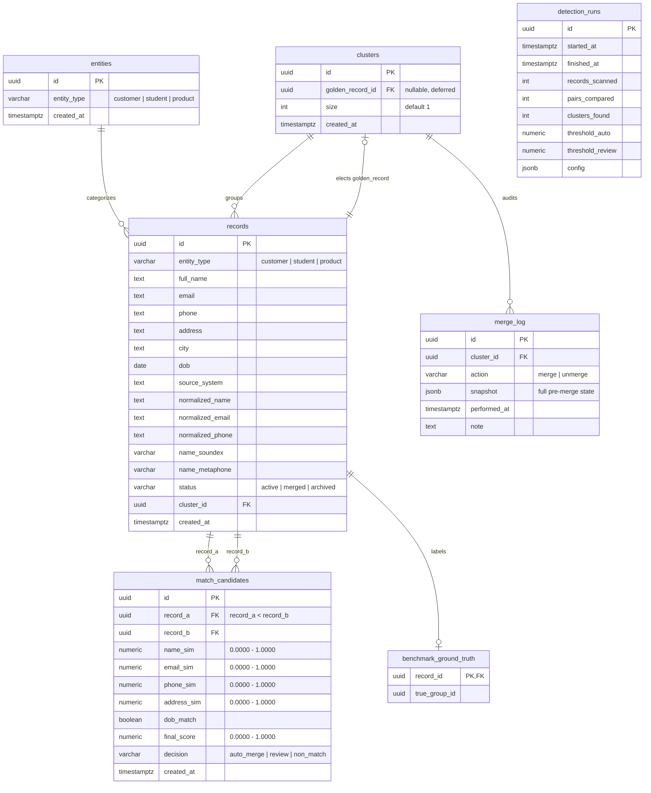

# DedupeIQ Entity-Relationship Diagram (ERD)

The DedupeIQ schema is engineered in **Third Normal Form (3NF)** to support high-throughput deduplication, fuzzy record linkage, auditable survivorship, and scientific benchmarking with ground-truth validation.

## Relational Constraints & Keys
1. **Primary Key Format**: Standard UUIDv4 (`gen_random_uuid()`) to prevent ID collision across distributed source systems.
2. **Canonical Candidate Ordering**: `CHECK (record_a < record_b)` guarantees that each pair is evaluated at most once, and `UNIQUE(record_a, record_b)` enforces strict idempotency.
3. **Cluster & Record Linkage**: `clusters.golden_record_id` is an initially deferred foreign key referencing `records.id`, while `records.cluster_id` is an `ON DELETE SET NULL` foreign key referencing `clusters.id`.
4. **Candidate Referential Integrity**: Both `record_a` and `record_b` have `ON DELETE CASCADE` constraints so removing a record automatically purges invalid candidate pairs.
5. **Merge Traceability**: `merge_log` captures complete pre-action JSONB snapshots allowing 100% reversible rollbacks.
